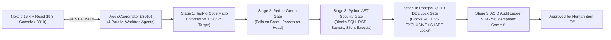

# Aegis-CI: Multi-Agent Worktree Release Gate, Red-to-Green Test Verifier & PostgreSQL 18 Lock Analyzer

[](https://aegis-ci.vercel.app)
[](https://github.com/whysari/aegis-ci/actions/workflows/ci.yml)
[](https://www.python.org/)
[](https://nextjs.org/)
[](https://www.typescriptlang.org/)
[](#empirical-benchmark-30-multi-agent-pr-candidates)

> **Live Interactive Release Gate Console:** **[https://aegis-ci.vercel.app](https://aegis-ci.vercel.app)** *(5-stage pipeline visualizer, 7 preset defect scenarios, PostgreSQL 18 DDL lock analyzer with Expand/Contract rewrites, Python AST security auditor, and 30-PR benchmark matrix)*

**Aegis-CI** is an autonomous multi-agent software delivery coordinator, static AST security gate, and zero-downtime PostgreSQL 18 migration lock analyzer. It orchestrates parallel coding agents in isolated `git worktree` branches and enforces a deterministic **5-Stage Release Gate** before any patch reaches human sign-off or production deployment.

---

## 1. Multi-Stack System Architecture

- **Next.js 16.4 + React 19.3 + TypeScript 7 Release Console (`frontend/`):** Interactive 5-stage pipeline visualizer, 4-worktree agent stream monitor, 1-click preset fault injector, live Python AST & PostgreSQL DDL migration inspector with Expand/Contract rewrite recommendations, and a filterable 30-PR benchmark matrix.
- **Python 3.13 FastAPI & Threaded WSGI Engine (`aegis/api.py`):** Exposes `/api/v1/healthz`, `/api/v1/stats`, `/api/v1/verdicts`, `/api/v1/evaluate`, `/api/v1/benchmark/run`, and `/metrics` (Prometheus text exposition).
- **PostgreSQL 18 Zero-Downtime DDL Lock Analyzer (`aegis/sql_analyzer.py`):** Detects 6 table-locking hazards (`PG-LOCK-001` through `PG-LOCK-006`) before deployment and generates safe Expand/Contract SQL rewrites.
- **Python AST Security & Reliability Auditor (`aegis/ast_auditor.py`):** Traverses `ast.parse()` trees (`ast.NodeVisitor`) to quarantine SQL injection f-strings (`AST-SEC-001`), `shell=True`/`eval` RCE (`AST-SEC-002`), hardcoded credentials (`AST-SEC-003`), silent `except: pass` blocks (`AST-REL-004`), and mutable default arguments (`AST-REL-005`).
- **ACID Idempotent Audit Ledger (`aegis/coordinator.py`, `deploy/postgres/init.sql`):** Persists every release verdict with a deterministic SHA-256 `idempotency_key` (`ON CONFLICT DO NOTHING`) across SQLite WAL and PostgreSQL 18.



---

## 2. The 5-Stage Zero-Rollback Release Gate

| Stage | Rule IDs | What It Enforces | Production Failure Mode Prevented |
| :--- | :--- | :--- | :--- |
| **Stage 1: Test-to-Code Ratio** | `STAGE_1` | Audits changed test lines vs. production lines ($\ge 1.5\times$ / $2:1$ standard). | Blocks under-tested patches submitted by autonomous coding agents. |
| **Stage 2: Strict Red-to-Green Proof** | `STAGE_2` | Verifies the new regression test **fails on `HEAD~1`** (buggy base) and **passes on `HEAD`** (patched worktree). | Rejects **tautological tests** that pass even when the bug is still present. |
| **Stage 3: Python AST Security & Reliability** | `AST-SEC-001`..`003`, `AST-REL-004`..`005` | `ast.NodeVisitor` inspection blocking SQLi f-strings, `shell=True`, hardcoded API tokens, swallowed `except: pass`, and mutable default args. | Prevents SQL injection, RCE, credential leaks, and silent compliance data loss (e.g., dropped AML/KYB records). |
| **Stage 4: PostgreSQL 18 DDL Lock Gate** | `PG-LOCK-001`..`006` | Flags `CREATE INDEX` without `CONCURRENTLY` (`SHARE` lock), `ALTER COLUMN TYPE` (`ACCESS EXCLUSIVE` rewrite), volatile `DEFAULT`, unvalidated `FOREIGN KEY`, `SET NOT NULL`, and missing `lock_timeout`. | Prevents database lock queues and zero-downtime deployment outages; outputs safe Expand/Contract rewrites. |
| **Stage 5: Atomic ACID Audit Ledger** | `SHA-256` | Commits every gate verdict with an idempotent SHA-256 key (`ON CONFLICT DO NOTHING`). | Guarantees tamper-evident auditability across concurrent CI retries. |

---

## 3. Empirical Benchmark Results (30 Multi-Agent PR Candidates)

| Benchmark Dimension | Measured Result | Verification Details |
| :--- | :--- | :--- |
| **Valid Test-First PRs Approved** | **12 / 12 (100.0%)** | Clean patches with $>2:1$ test ratio and `CONCURRENTLY` DDL migrations |
| **Defective / Unsafe PRs Quarantined** | **18 / 18 (100.0%)** | 3 tautological tests, 3 low-coverage, 6 PG lock hazards, 6 AST/regression defects |
| **Unsafe PRs Leaked (Rollback Risk)** | **0 / 30 (0.0%)** | Zero false approvals (`Precision = 100.0%`, `Recall = 100.0%`) |
| **ACID Audit Ledger Persistence** | **30 / 30 (100.0%)** | Idempotent SHA-256 deduplication verified across retries |

---

## 4. Quickstart & Verification

```bash
# 1. Run Python 3.13 release gate & API test suite (13 tests)
python3 -m unittest discover -s tests -v

# 2. Run standalone 30-PR multi-agent benchmark
python3 benchmarks/run_aegis_benchmark.py

# 3. Run Next.js 16.4 + TypeScript 7 frontend & live WSGI contract test suite (11 tests)
cd frontend && bun test

# 4. Launch full containerized stack (FastAPI/WSGI + Next.js 16.4 + PostgreSQL 18 + Prometheus 3.10)
docker compose up --build
```
- **Next.js 16.4 Release Gate Console:** `http://localhost:3010`
- **REST API & Health:** `http://localhost:8010/api/v1/stats`
- **Prometheus Metrics (`/metrics`):** `http://localhost:8010/metrics`
