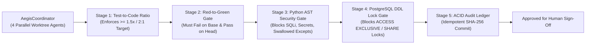

# Aegis-CI: Multi-Agent Worktree Release Gate, Red-to-Green Test Verifier & PostgreSQL Lock Analyzer

[](https://github.com/whysari/aegis-ci/actions/workflows/ci.yml)
[](https://www.python.org/)
[](https://nextjs.org/)
[](#empirical-benchmark-30-multi-agent-pr-candidates)

**Aegis-CI** is an autonomous multi-agent software delivery coordinator and deterministic release-gate engine inspired by high-velocity production engineering workflows (**228 PRs merged with zero rollbacks across 4 parallel Claude Code agents**). It orchestrates parallel coding agents in isolated `git worktree` branches and enforces a strict **5-Stage Release Gate** before any agent patch can reach human sign-off or production deployment.

---

## Architecture: The 5-Stage Zero-Rollback Release Gate



---

## Core Engineering Subsystems

| Subsystem | What It Enforces | Production Failure Mode Prevented |
| :--- | :--- | :--- |
| **Stage 1: Test-to-Code Ratio Gate** | Audits changed test lines vs. production lines (enforcing up to a 2:1 test-to-code standard). | Blocks under-tested patches submitted by autonomous coding agents. |
| **Stage 2: Strict Red-to-Green Gate** | Verifies the new regression test **fails on `HEAD~1`** (unpatched base) and **passes on `HEAD`** (patched worktree). | Rejects **tautological/false tests** that pass even when the bug is still present. |
| **Stage 3: Python AST Security & Reliability (`PythonAstAuditor`)** | Traverses `ast.parse()` trees to block unparameterized SQL f-strings (`AST-SEC-001`), `shell=True`/`eval` (`AST-SEC-002`), hardcoded secrets (`AST-SEC-003`), silent `except: pass` blocks (`AST-REL-004`), and mutable defaults (`AST-REL-005`). | Prevents SQL injection, credential leaks, and silent compliance data loss (such as swallowed AML/KYB persistence errors). |
| **Stage 4: PostgreSQL DDL Migration Lock Analyzer (`PostgresMigrationLockAnalyzer`)** | Detects 6 table-locking DDL hazards (`PG-LOCK-001`..`006`): `CREATE INDEX` without `CONCURRENTLY`, `ALTER COLUMN TYPE` table rewrites, volatile `DEFAULT` rewrites, unvalidated `FOREIGN KEY`/`CHECK` scans, `SET NOT NULL` scans, and missing `SET LOCAL lock_timeout`. | Prevents database lock queues and zero-downtime deployment outages; outputs safe Expand/Contract rewrites. |
| **Stage 5: Atomic ACID Audit Ledger** | Persists every gate verdict with a deterministic SHA-256 `idempotency_key` (`ON CONFLICT DO NOTHING`). | Guarantees complete, idempotent auditability across concurrent CI retries. |
| **Dual REST / WSGI API (`aegis/api.py`)** | Standard-library WSGI & FastAPI ASGI endpoints on port `8010` (`/api/v1/healthz`, `/api/v1/evaluate`, `/api/v1/benchmark/run`, `/metrics`). | Serves real-time evaluation requests, Prometheus telemetry, and console integrations. |
| **Console UI (`frontend/`)** | Next.js 15 App Router + React 19 + TypeScript + Bun console on port `3010`. | Live PR inspection, 4 agent worktree lanes, and 30-PR benchmark matrix. |

---

## Empirical Benchmark (30 Multi-Agent PR Candidates)

Run the full Python test suite and Bun test suite locally:

```bash
# Python unit tests and API suite (13 tests)
python3 -m unittest discover -s tests -v

# Frontend component and runtime type-guard test suite (12 tests)
cd frontend && bun test

# Standalone 30-PR terminal benchmark
python3 benchmarks/run_aegis_benchmark.py
```

| Benchmark Dimension | Measured Result | Details |
| :--- | :--- | :--- |
| **Valid Test-First PRs Approved** | **12 / 12 (100.0%)** | Clean patches with >2:1 test ratio and concurrent DDL migrations |
| **Defective / Unsafe PRs Quarantined** | **18 / 18 (100.0%)** | 3 tautological tests, 3 low-coverage, 6 PG lock hazards, 6 AST/regression defects |
| **Unsafe PRs Leaked (Rollback Risk)** | **0 / 30 (0.0%)** | Zero false approvals across all 4 parallel agent streams |
| **ACID Audit Ledger Persistence** | **30 / 30 (100.0%)** | Idempotent SHA-256 deduplication verified |

---

## Docker Compose Quickstart

Stand up the full microservices stack:
```bash
docker compose up --build
```
- Web Console: [http://localhost:3010](http://localhost:3010)
- REST API / WSGI: [http://localhost:8010](http://localhost:8010)
- Prometheus Scraper: [http://localhost:9091](http://localhost:9091)
